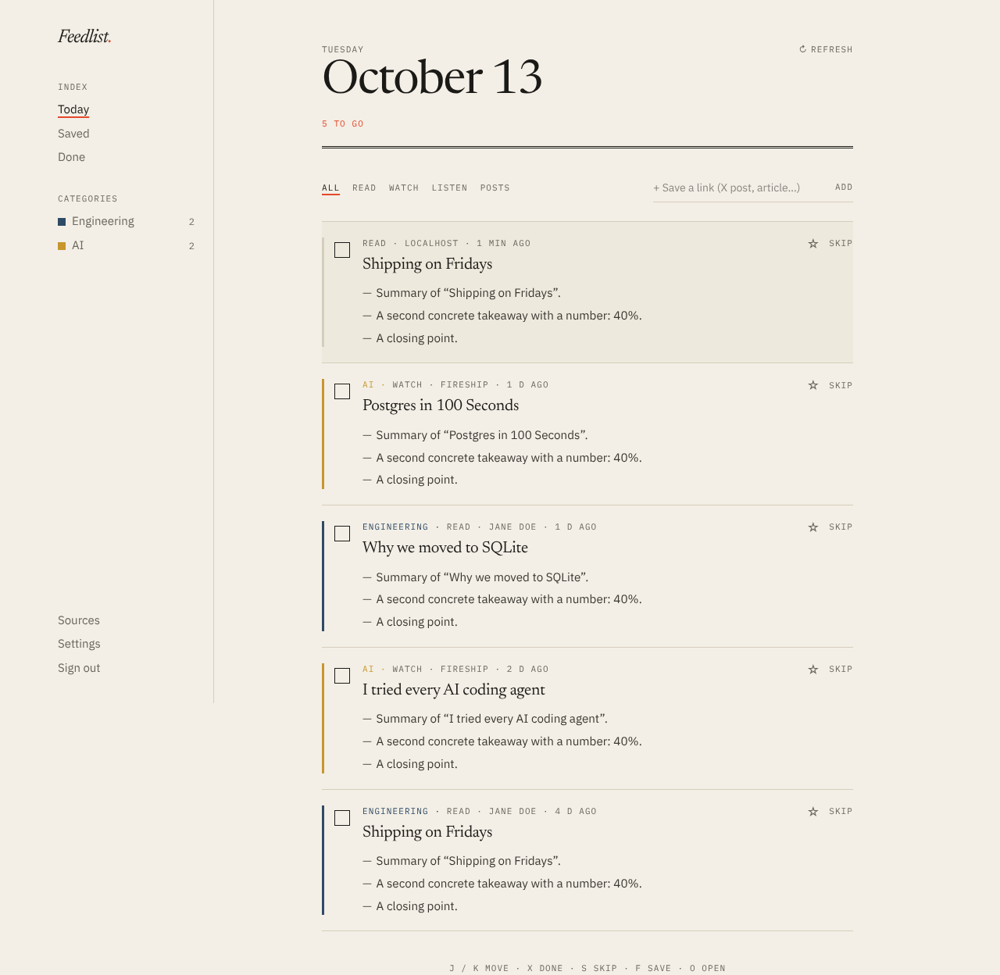
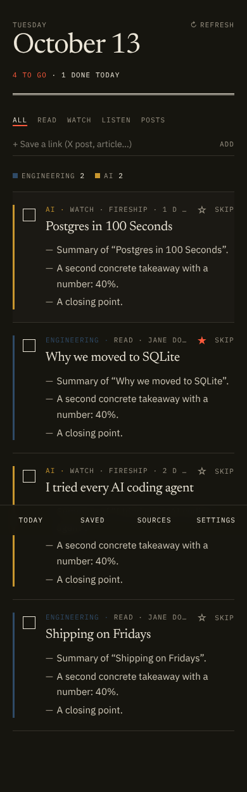

# Feedlist

**Everything you follow, as a checklist.** Feedlist pulls new posts from the blogs, YouTube channels,
subreddits, podcasts and topics you care about, writes a 3–5 bullet summary for each, and puts them
in an inbox you tick off as you read or watch.

Open source and self-hostable. Bring your own AI: Claude, ChatGPT, Mistral, Grok, Gemini, or any
OpenAI-compatible endpoint (Ollama, vLLM, LM Studio, OpenRouter…).

<p>
  
  
</p>

## What it does

- **Follow anything with a feed.** Paste a URL and Feedlist finds the feed: YouTube channels
  (`/@handle`, `/channel/…`, playlists), subreddits, Hacker News, Bluesky and Mastodon profiles,
  Substack, podcasts, any blog with RSS/Atom.
- **Watch a topic.** Follow a phrase like “Claude Code” across Google News, Hacker News and Reddit.
- **Save single links.** For things without a feed (X/Twitter posts, a one-off article). Works from
  the phone's share sheet once Feedlist is installed as an app, or via the bookmarklet.
- **Categories and creators.** Group sources by topic, and group one person's channels together.
- **Every item is a to-do.** Tick it off, skip it, or ★ save it for later. Untouched items auto-archive
  after N days, so the inbox never becomes a guilt pile. Keyboard: `j`/`k` move, `x` done, `s` skip,
  `f` save, `o` open.
- **Summaries in English** from the article text or the video description, using your own model.
- **Daily email digest** (optional, needs SMTP).
- **Installable PWA**, light and dark mode.

## Run it

You need Node 22+, pnpm and a Postgres database (local, Docker, [Neon](https://neon.tech) or
[Supabase](https://supabase.com) free tiers all work).

```bash
cp .env.example .env        # set DATABASE_URL, BETTER_AUTH_SECRET, CRON_SECRET
pnpm install
pnpm db:migrate
pnpm dev                    # http://localhost:3000
```

Create an account, add your AI key under **Settings**, then follow a few sources under **Sources**.
New items are fetched on a schedule (see below); **Refresh** on the Today page fetches immediately.

### Self-host with Docker

```bash
cp .env.example .env        # set BETTER_AUTH_SECRET and CRON_SECRET at least
docker compose up -d
```

The container runs migrations on start and fetches feeds in-process (`INTERNAL_CRON=true`), so
nothing else is needed. Put it behind a reverse proxy with HTTPS and set `BETTER_AUTH_URL` to the
public URL. Once your account exists, set `ALLOW_SIGNUP=false` if the instance is just for you.

### Deploy on Vercel

1. Create a Postgres database on Neon or Supabase and copy its **pooled** connection string.
2. Import the repo in Vercel and set `DATABASE_URL`, `BETTER_AUTH_URL`, `BETTER_AUTH_SECRET` and
   `CRON_SECRET`. Migrations run during the build (`vercel.json`).
3. Scheduling: Vercel's free plan only allows a daily cron. For fetching every 30 minutes, add the
   repository secrets `FEEDLIST_URL` and `CRON_SECRET`; the included GitHub Action
   (`.github/workflows/fetch.yml`) calls `/api/cron` on that schedule. Any external cron service
   works too:

   ```bash
   curl -H "Authorization: Bearer $CRON_SECRET" https://your-feedlist.example.com/api/cron
   ```

## AI providers

Each user picks a provider and pastes their key in **Settings**. Keys are encrypted at rest
(AES-256-GCM, derived from `BETTER_AUTH_SECRET`) and only used to summarize that user's items.
**Test connection** checks the key before you save.

| Provider | Default model | Notes |
|---|---|---|
| Anthropic | `claude-haiku-5-5` | |
| OpenAI | `gpt-5.4-mini` | |
| Mistral | `mistral-small-latest` | |
| xAI | `grok-latest` | |
| Google | `gemini-3.5-flash-lite` | |
| OpenAI-compatible | — | Base URL + model, e.g. `http://localhost:11434/v1` + `llama3.2` for Ollama |

Running a personal instance? Set `AI_PROVIDER`, `AI_MODEL` and `AI_API_KEY` in `.env` to use one key
for every account that doesn't bring its own. Leave them empty on a shared instance.

## X / Twitter

X has no free API or feeds, so Feedlist can't follow accounts out of the box. Options:

- Save individual posts with **Save a link** or the share sheet.
- Run [RSSHub](https://docs.rsshub.app) yourself and set `RSSHUB_URL`; pasting an `x.com/handle` URL
  then follows it through RSSHub.

## How it works

```
sources ──► scheduler (/api/cron or in-process) ──► new entries ──► one item per subscriber
                                                                      │
                                       article text / video description│
                                                                      ▼
                                             user's AI model ──► 3–5 bullets ──► inbox
```

- **Next.js 16** (App Router, server actions) + **Tailwind CSS 4**
- **Postgres** via **Drizzle ORM**; schema in `src/db/schema.ts`, migrations in `drizzle/`
- **Better Auth** for email/password and optional GitHub login
- **Vercel AI SDK** for the provider-agnostic summaries (`src/lib/ai`)
- Feeds are shared: each feed is fetched once per cycle no matter how many users follow it
  (conditional requests with ETag / Last-Modified, exponential backoff on errors)

## Development

```bash
pnpm test         # unit tests (feed parsing, discovery, crypto)
pnpm lint
pnpm typecheck
pnpm jobs         # run one scheduler tick from the CLI
pnpm db:generate  # after editing src/db/schema.ts
node test/fake-server.mjs   # local fixture feeds + fake OpenAI-compatible model on :4010
```

## License

MIT
